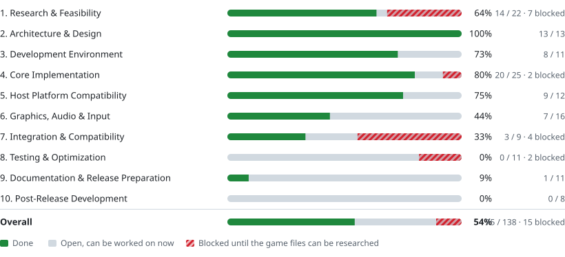
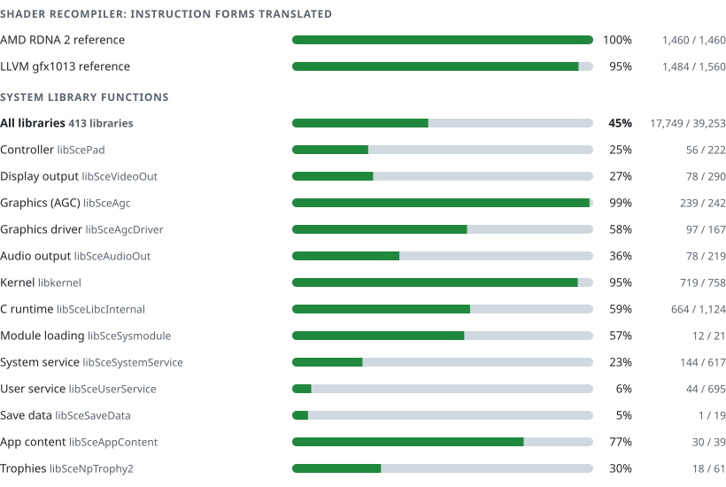

# GTA VI Translation Layer

A project to run the PlayStation 5 build of Grand Theft Auto VI natively on PC,
built on [AnyPS5](https://github.com/boykopovar/AnyPS5).

AnyPS5 converts a PS5 executable into a native Windows or Linux program and links
it against its own implementations of the PS5 system libraries. The game's code
runs directly on the PC's processor: nothing is emulated, and the game's code is
not rewritten. This project adds what is specific to GTA VI: research into what
the game needs, fixes and library work contributed back to AnyPS5, game-specific
patches and configuration, and progress tracking.

**Status:** Early development. AnyPS5 provides the relinker, 413 system libraries
and a shader recompiler, but nothing has been tested with GTA VI, and the project
makes no compatibility claims.

**Research availability:** Development is limited by what can be researched
without game files. The project will not work from game content, extracted
assets, PS5 system files, decryption keys, or leaked material, in order to avoid
DMCA exposure for contributors and the project. Until GTA VI's files can be
researched lawfully, work that depends on them is blocked; the progress section
below shows how much. Work that needs none of that material (documentation,
upstream library work in AnyPS5, tooling) continues.

## Progress

<!-- progress:start -->
<!-- Generated by scripts/update_progress.py. Do not edit by hand. -->

> [!WARNING]
> **Game research is blocked.** No GTA VI files can be researched lawfully yet,
> so 15 of 138 roadmap tasks (11%) cannot start.
> Until that changes, the project works from public research and builds on
> [AnyPS5](https://github.com/boykopovar/AnyPS5) to move faster.

**[View the progress page](https://jamescicada.github.io/GTAVI-Recomp/)**

### Roadmap

<picture>
  <source media="(prefers-color-scheme: dark)" srcset="progress/roadmap-dark.svg">
  
</picture>

Details in [TODO.md](TODO.md).

### Foundation from AnyPS5

Measured by AnyPS5's own `tools/progress.py` at the pinned commit [`1582613`](https://github.com/boykopovar/AnyPS5/tree/15826135019b8c7de27f42661a850a1dd9750932).

<picture>
  <source media="(prefers-color-scheme: dark)" srcset="progress/anyps5-dark.svg">
  
</picture>

The libraries listed are ones nearly every PS5 game imports; GTA VI's actual
list is unknown until its files can be researched. A translated shader
instruction or implemented function is counted from source code and does not
show that a game runs. The recompiler still has 126
code paths that report an unsupported case.
<!-- progress:end -->

## Overview

The goal is to run the PS5 build of the game on a normal PC without rewriting the
game or emulating the console's hardware.

A PS5 title is an ordinary x86-64 program that expects a specific operating
system, a specific set of system libraries, and a specific graphics and audio
stack. AnyPS5 supplies those on the PC:

- its **relinker** converts the game's executable, ahead of time, into a native
  Windows (PE) or Linux (ELF) program whose imports point at AnyPS5's libraries
  instead of Sony's;
- its **system libraries** (`libkernel`, `libScePad`, `libSceAudioOut`, ...)
  provide files and PS5 mount points such as `/app0`, memory, threads, audio and
  controller input on top of the host operating system;
- its **graphics driver and shader recompiler** translate the PS5 graphics command
  stream to Vulkan and the game's GPU shaders to SPIR-V.

The game itself is never shipped by this project. Users supply their own copy,
and the converted executable is produced on their machine and never distributed.

## Features & Goals

- **Built on AnyPS5:** Use its relinker, libraries and shader recompiler instead
  of writing a separate translation layer.
- **Upstream first:** Work any PS5 title could use goes to AnyPS5; this
  repository keeps what is specific to GTA VI.
- **No emulation:** The game's code runs natively; only system library calls are
  served by AnyPS5's implementations.
- **Graphics on Vulkan:** The PS5 graphics command stream and shaders are
  translated to Vulkan and SPIR-V.
- **Audio and input:** PS5 audio output and controller input on the host, with
  keyboard and mouse mapping.
- **Host portability:** Windows and Linux hosts from one codebase.
- **Clear progress:** Generated progress charts show what is done, what is open,
  and what is blocked on game files.
- **Community-driven development:** Welcome contributions from developers,
  researchers, testers, and AI coding agents.

## Architecture

```text
   PS5 game build (supplied by the user)
   eboot executable + bundled modules
                  |
                  v
        AnyPS5 relinker  (ahead of time, on the user's machine)
   converts to a native program, imports bound by NID
                  |
                  v
   Native program  --->  AnyPS5 system libraries (libkernel, libScePad, ...)
   (app.exe / app.elf)   graphics driver + shader recompiler -> Vulkan
                  |
        +---------+---------+
        |                   |
        v                   v
   Windows host         Linux host
```

This repository sits beside AnyPS5: it holds GTA VI's research, patches,
configuration and tests, and AnyPS5 is pinned as a submodule in
`third_party/AnyPS5`. The decision and its reasons are recorded in
[ADR 0003](docs/adr/0003-build-on-anyps5-relinker.md); AnyPS5's own design is in
its [architecture document](third_party/AnyPS5/docs/dev/ARCHITECTURE.md).
Individual decisions are recorded as ADRs under [docs/adr/](docs/adr/).

## Platform Support

| Target | Status |
| --- | --- |
| Guest: GTA VI, PS5 build | Not tested: the game files cannot be researched yet |
| AnyPS5 on Windows | [Full Release build verified](docs/build.md#building-the-pinned-anyps5-runtime-on-windows) at `1582613` with MinGW-w64 GCC 15.2.0. Five fixture tests passed. |
| AnyPS5 on Linux | Supported upstream; not yet built by this project |
| This repository's tooling | Builds and tests pass on Windows (MSVC) and Linux (GCC, Clang) |

Nothing here is a statement that the game currently runs.

## Repository Layout

```text
third_party/AnyPS5/ AnyPS5, pinned as a git submodule
docs/               ADRs, research, build notes
progress/           generated progress charts and AnyPS5 measurements
site/               the progress page published to GitHub Pages
scripts/            progress generator, Discord setup, build helpers
bot/                Cal Hampton, the Discord bot (/progress, /faq, /updates)
include/gtavi/      project tooling: public headers
src/                project tooling: implementation (OS-specific code in src/platform/)
tools/probe/        gtavi-probe diagnostic front end
tests/              unit tests for the project tooling
cmake/              shared build configuration
```

The `gtavi` code under `include/`, `src/` and `tools/` is project tooling. It is
not on the game's runtime path; see [ADR 0003](docs/adr/0003-build-on-anyps5-relinker.md).

## Building from Source

This repository's own tooling needs CMake 3.21+ and a C++20 compiler. On Windows,
the helper script locates the Visual Studio toolchain and runs all three steps:

```bat
scripts\build-windows.bat
```

Otherwise:

```bash
cmake --preset debug
cmake --build --preset debug
ctest --preset debug
```

Full instructions are in [docs/build.md](docs/build.md).

AnyPS5 is built separately with its own toolchain (MinGW-w64 GCC on Windows).
Fetch it with `git submodule update --init --recursive third_party/AnyPS5` and
follow its [build instructions](third_party/AnyPS5/docs/dev/BUILD.md).

## Development Roadmap

Development is organized into several phases:

1. **Research & Feasibility** — Learn what GTA VI needs from the PS5 platform,
   starting from what AnyPS5 already documents.
2. **Architecture & Design** — Build on AnyPS5 and record the decisions.
3. **Development Environment** — Build systems, CI, and building AnyPS5.
4. **Core Implementation** — Fill gaps in the libraries GTA VI is likely to need,
   upstream in AnyPS5.
5. **Host Platform Compatibility** — Verify behaviour on Windows and Linux hosts.
6. **Graphics, Audio & Input** — Complete the graphics driver, shaders, audio and
   controller libraries.
7. **Integration & Testing** — Test GTA VI once its files can be researched
   lawfully, and fix what fails.
8. **Optimization** — Improve performance, stability, and resource usage.
9. **Release Preparation** — Complete documentation and prepare public releases.

For a detailed breakdown of tasks and progress, see [TODO.md](TODO.md).

## Contributing

Contributions are welcome from developers, researchers, reverse engineers, testers, documentation writers, and AI coding agents.

AI-assisted development is explicitly permitted. Contributors can use tools such as Codex, Claude Code, GitHub Copilot, Cursor, and other coding agents.

We aim to keep the contribution process straightforward, allowing contributors and agents to research, implement, test, and submit changes without unnecessary bureaucracy.

Before contributing, please read [CONTRIBUTE.md](CONTRIBUTE.md) for development guidelines, contribution instructions, and AI agent policies.

Documentation for the codebase lives in [docs/](docs/README.md), including build
instructions and the architecture decision that defines the translation
approach.

## Community & Updates

Join the community to follow development progress, discuss technical research, share ideas, and participate in the project.

**Discord:** [Join the community](https://discord.gg/RTwXeccCqD)

Development updates, announcements, and discussions are shared through our Discord
server; new commits to `main` are posted there automatically. Its channels, rules
and FAQ are in [docs/community/discord.md](docs/community/discord.md).

## Disclaimer

This is an independent, community-driven project. It is not affiliated with,
endorsed by, or associated with Rockstar Games, Take-Two Interactive, or Sony
Interactive Entertainment.

Grand Theft Auto and GTA VI are trademarks of their respective owners.
PlayStation is a trademark of Sony Interactive Entertainment.

This project does not distribute GTA VI game files, copyrighted assets,
proprietary source code, PS5 system files, or decryption keys.

## Support Development

If you find this project interesting and want to support its development, consider supporting me on Ko-fi.

[Support development on Ko-fi](https://ko-fi.com/jcicada)

## Star History

<a href="https://www.star-history.com/?type=date&repos=JamesCicada%2FGTAVI-Recomp">
 <picture>
   <source media="(prefers-color-scheme: dark)" srcset="https://api.star-history.com/chart?repos=JamesCicada/GTAVI-Recomp&type=date&theme=dark&legend=top-left" />
   <source media="(prefers-color-scheme: light)" srcset="https://api.star-history.com/chart?repos=JamesCicada/GTAVI-Recomp&type=date&legend=top-left" />
   
 </picture>
</a>

## License

Released under the [GNU General Public License, version 2 only](LICENSE)
(GPL-2.0-only), the same license as AnyPS5, whose code this project builds on.

The license covers this project's own source code and documentation only. It
grants no rights to GTA VI, its assets, or any Sony or Rockstar Games material.

## Acknowledgements

This project builds on [AnyPS5](https://github.com/boykopovar/AnyPS5) rather
than reinventing it. AnyPS5's relinker, shader recompiler, and system-library
implementations, and the research behind them, are the foundation this project
uses; it is included as a git submodule under `third_party/AnyPS5` and keeps its
own copyright and license. Work that is not specific to GTA VI should go
upstream to AnyPS5.
